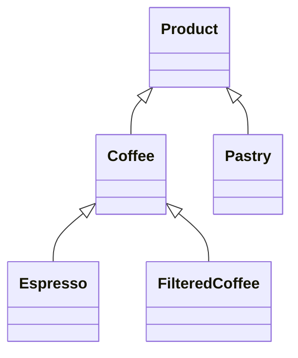

# Cafetería Origen API

API REST para gestionar productos, pedidos y reportes de ventas de una cafetería.

## Integrantes - Grupo N-8

Iñaki Carcereny · Valentín De Pascale · Joaquín Marcilese · Ezequiel Barrionuevo

## Stack

- Node.js + Express + TypeScript
- pnpm
- Vitest + Supertest (tests unitarios + e2e)
- ESLint + Prettier
- Husky + commitlint (Conventional Commits)
- Zod

## Cómo arrancar

```bash
pnpm install
pnpm dev
```

El servidor levanta en `http://localhost:3000` por defecto.

## Scripts

```bash
pnpm dev        # arranca en modo watch
pnpm build      # compila TypeScript
pnpm start      # corre el build compilado
pnpm test       # corre los tests una vez
pnpm test:watch # corre los tests en modo watch
pnpm lint       # corre eslint
```

## Endpoints

| Método | Ruta                    | Descripción                    |
| ------ | ----------------------- | ------------------------------ |
| GET    | `/health`               | Chequeo de estado del servidor |
| GET    | `/products`             | Lista todos los productos      |
| GET    | `/products/:id`         | Devuelve un producto por id    |
| POST   | `/orders`               | Crea un pedido                 |
| GET    | `/orders`               | Lista todos los pedidos        |
| GET    | `/orders/:id`           | Devuelve un pedido por id      |
| GET    | `/reports/revenue`      | Facturación total              |
| GET    | `/reports/best-selling` | Producto más vendido           |

## Modelo de dominio

`Product` es una clase base abstracta. `Coffee` (abstracta) extiende de ahí y se especializa en `Espresso` y `FilteredCoffee`; `Pastry` extiende directamente de `Product`. Cada subclase implementa `calculatePrice()`.


